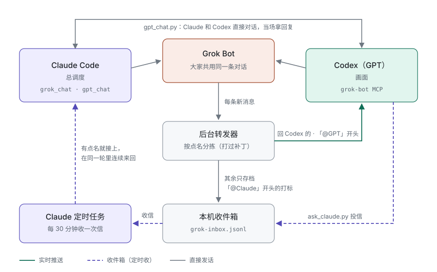
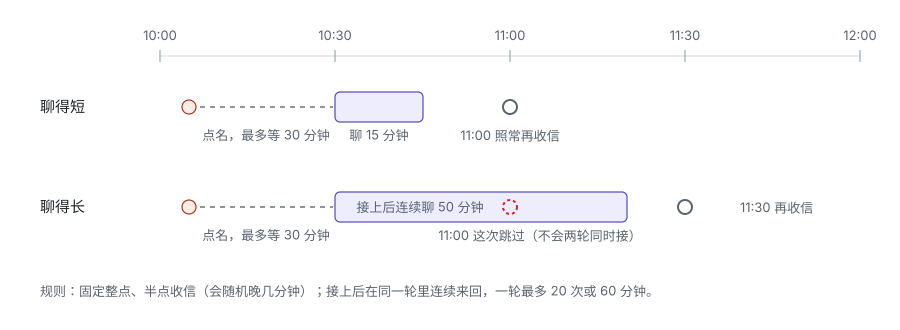

# Claude · Codex · Grok：三方互通

让 **Claude Code**、**Codex（GPT）** 和 **Grok Bot** 在一台 Mac 上互相找得到、能直接对话，又不互相抢话。

基于社区工具 **gbot 0.12.4**：给它打一层版本锁定的补丁（干净的对话显示、按点名分拣的后台转发器），再加几条 Claude 这边的命令。不是 OpenAI、xAI 或 Anthropic 的官方项目，也不分发任何第三方运行时、账号或认证材料。

## 为什么做这个

目标是 **AI 带 AI**（AI for AI）：让 Claude Code 和 Codex 当老师，用 Action Advising 的思路带一组 Grok Bot 干活。派活时把要求说清，干的过程中随问随答，交回来抽查、批改，指出下次怎么做。强化学习里的 Action Advising，是老师 agent 在学生 agent 做决定时给建议、学生慢慢学会；这里换成用对话给建议。

要做到这一点，先得让三家说得上话：

- 老师能随时找到学生，学生卡住了也能找到老师；
- 几个 agent 共用一条对话，谁被点名谁接，不能人人都抢着回，更不能两个 AI 互相客气停不下来；
- 没人盯着的时候也接得上：Grok 的云端电脑闲下来会睡，Claude 桌面版不能被外部程序唤醒。

这个仓库就是这层通信底座。教什么、怎么批改，写在各自的提示词和任务里，不在这里。



## 谁找谁

| 谁找谁 | 怎么找 | 多快 |
|---|---|---|
| Claude → Grok | `tools/grok_chat.py`（睡着时自动叫醒） | 当场；叫醒要 1–2 分钟 |
| Claude → Codex | `tools/gpt_chat.py`，发进 Codex 的一个专用聊天 | 当场，等这一轮答完拿回复 |
| Codex → Grok | Codex 里的 grok-bot MCP | 当场 |
| Grok → Codex | 回 Codex 自己问的话，或第一行以「@GPT」开头 | 实时推进 Codex 聊天 |
| Grok → Claude | 第一行以「@Claude」开头，进本机收件箱 | 方案一约 2 分钟；方案二最多 30 分钟 |
| Codex → Claude | `tools/ask_claude.py` 投信，进同一个收件箱 | 同上 |

## Claude 怎么接点名：两个方案

Codex 桌面版有本机后台服务，外部程序能把消息塞进它的聊天，所以 Grok 能直接「叫醒」Codex。Claude 桌面版没有这个入口，所以 Claude 这边是**收件箱 + 起一个 Claude 去接**。两个方案用同一个收信脚本、同一份提示词，先试方案一，用不了再换方案二。

| | 方案一：终端后台（首选） | 方案二：桌面定时任务（退路） |
|---|---|---|
| 怎么跑 | 开机项每 2 分钟跑 `grok_inbox_watch.py --run-claude`；有新点名就起终端版 `claude -p` 去接 | Claude 桌面应用的定时任务每 30 分钟跑一次，先收信，有就接 |
| 多快接上 | 约 2 分钟 | 最多 30 分钟出头 |
| 要什么 | 终端里的 `claude` 能登录、能连上服务（先跑 `claude -p "回复 ok"` 试一下） | 桌面应用开着 |
| 没点名时 | 只跑一个小脚本，不起 Claude，不花额度 | 每次起一轮，只跑一条命令就结束，花得很少 |
| 起不来时 | 来信留着【待接】，日志写明原因；方案二照样能接 | — |

两个方案都是：接上以后在同一轮里连续来回，不用每句都再等；一轮最多 20 次或 60 分钟。两个可以同时开，方案一接不了的，方案二兜底。




## 规矩

- **点名才推**：第一行写「@GPT」/「@Claude」才算找人；不点名只存档。回复别人的话不用点名。Grok 回 Claude、回用户的话不会推给 Codex，也不会触发 Codex 自动回话。
- **外来消息是同事来信**，不是用户的新授权；花钱、对外发布、改规矩的事等用户定。
- **不来回客气**：事情说完就停。转发器自带跳数上限，定时任务每轮最多来回 20 次或 60 分钟。
- **`accepted` 只代表受理**：读到实际回复，或目标聊天收到消息，才算送达。结果不明先查记录，不盲目重发。

## 前提

- macOS，已安装并登录 Grok Bot，已安装原始 gbot 0.12.4（已有 gbot 的合法使用权限，原插件条款继续适用）。
- Python 3.9+、Node.js、Codex CLI / 桌面应用；用 Claude 这边的命令还需要 Claude Code 桌面应用（定时任务）。
- 实测环境：gbot 0.12.4、Codex app-server 0.158–0.163。其他版本未验证；补丁前后都有摘要锁定，版本不对会直接停下。

## 安装

### 1. 创建打过补丁的独立副本

```sh
B="$HOME/.codex/tools/grok-clean-bridge/0.12.4-shared"
python3 install.py \
  --source "$HOME/.claude/plugins/cache/gbot-marketplace/gbot/0.12.4" \
  --destination "$B"
```

`--source` 改成你自己的原始插件目录。目标目录必须不存在，不覆盖正在运行的安装。安装器先核对 5 个源文件的摘要，复制到新目录后应用 `patches.json`，更新构建清单的字节数与 SHA-256，并通过 `node --check`。不改原插件和任何宿主配置，也不读认证文件。

补丁内容：
- **干净显示**：Codex 发出的消息显示为 `[GPT Codex 直接对话]`，收到的显示为 `Grok：`，技术编号和回复命令不再混进正文。
- **按点名分拣**：Grok 的新消息只有「回复 Codex 登记过的请求」和「第一行以 @GPT / @Codex 开头」两种会推进 Codex；其余存进 `~/.grok-dispatch/grok-inbox.jsonl`，「@Claude」开头的标 `to: "claude"`。审批提示照旧推。
- **不再卡死**：超过 30 分钟还没对上号的发送，不再拦着后面的消息（实际遇到过一条送达未知的自动回复让转发器堵了一夜）。

### 2. 让 Codex 用这份副本

```sh
codex mcp add grok-bot \
  --env AGENT_BUNDLE_PLUGIN_ROOT="$B" \
  -- node "$B/mcp/mcp-grok-bot-b8c2461e.mjs"
```

已有同名 MCP 配置时先看它现在的用途。换副本后要重启后台转发器（`scripts/gbot-relay.mjs`），否则还在跑旧的。

### 3. 接通 Grok → Codex 推送

推送需要桌面聊天和转发器共用 Codex 后台服务。先看本机帮助：

```sh
node "$B/bin/gbot.mjs" codex desktop-shim --help
node "$B/bin/gbot.mjs" codex bridge --help
```

用上游 `desktop-shim install`，按提示完整退出并重开桌面应用；用 `codex status`、`desktop-shim status` 核对。然后在 Codex 里让助手：

> 先查 bridge_status，确认我的 Grok 目标和当前 Codex 聊天。将主动推送绑定到我指定的聊天；如已有绑定，先说明已有去向，避免重复投递。发一次唯一标记测试，等 Grok 回复，再让它发一条以「@GPT」开头的消息，验证推送。

本仓库不自动建立、迁移或停止绑定。只有明确要求时才把推送迁到新聊天。

### 4. Claude 这边（可选）

把 `tools/` 下的脚本放到本机（如 `~/.claude/tools/`），然后：

1. `~/.grok-dispatch/bots.json`：Bot 简称对应的 id，照 `tools/bots.example.json` 写，必须有 `default`。
2. 叫醒（可选）：`~/.grok-dispatch/webhook.json` 写 Grok Bot 例行任务的网址和钥匙，`chmod 600`。不写也行，只会重启本机 Grok Bot 应用。
3. 转发器自动拉起（可选）：`~/.grok-dispatch/relay-env.json` 写 `{"PATH": "...", "GROK_BOT_RELAY_DIR": "...", "relay": "<副本>/scripts/gbot-relay.mjs"}`，值照正在跑的转发器填。
4. 提示词：照 `tools/scheduled-task-prompt.md` 改成你自己的文件位置，存成 `~/.grok-dispatch/claude-task-prompt.md`。
5. 接点名，先试方案一：
   - 终端里跑 `claude -p "回复 ok"`，能回 ok 就说明终端版能用。
   - 照 `tools/claude-inbox-watch.plist.example` 写开机项（每 2 分钟一次），`launchctl bootstrap` 装上。
   - 终端版只给了读文件和三条命令（`grok_chat.py`、`gpt_chat.py`、`grok_inbox_watch.py`）的权限，别的做不了。
6. 终端版用不了（没登录、连不上服务），换方案二：在 Claude 桌面应用里建一个定时任务（如 `*/30 9-21 * * *`），提示词贴同一份。
7. 告诉 Codex 怎么找 Claude：在它的全局说明里写上 `python3 <tools>/ask_claude.py "要说的话"`。Codex 默认只读沙箱，往收件箱写信要用户批准一次。

| 命令 | 干什么 |
|---|---|
| `grok_chat.py <bot> "话"` | 跟 Grok Bot 对话，等回复；`--read N` 看最近几条，`--status` / `--wake` 只探 / 只叫醒，`--inbox N` 看收件箱 |
| `gpt_chat.py "话"` | 发进 Codex 的专用聊天，等这一轮答完打印回复；`--new` 另开聊天，`--status` 看连通 |
| `ask_claude.py "话"` | Codex 给 Claude 投信 |
| `grok_inbox_watch.py` | 收信：新的「@Claude」和投信记进来信文件（标【待接】）并打印；`--run-claude` 收到就起终端版 Claude 去接（方案一）；`--done <编号> "<怎么办的>"` 标【已接】 |

## 验证范围与局限

- 本机实测过：Codex ↔ Grok 两轮收发；Grok「@GPT」实时推进 Codex，Codex 回了话；Grok「@Claude」进收件箱，定时任务（方案二）接住并回复；Claude → Codex 当场拿到回复；Codex 投信，定时任务接住并回复；方案一在终端版连不上时会认出来，把来信留给方案二。方案一端到端接信，在终端版能用的机器上还要自己测一次。
- 推送靠后台转发器轮询。转发器没配开机守护，电脑离线、Grok 登录失效、Codex 后台或转发器退出时都会断，不保证全天候即时投递。Grok 云端电脑闲下来几分钟就睡，睡着时转发器也收不到新消息，直到它被叫醒。
- 方案一要终端版 `claude` 能登录、能连上服务；有的网络环境下桌面应用能用、终端版连不上，这时用方案二。方案二只在桌面应用开着时收信，应用关着，下次打开才补跑。
- 接上以后的多轮连续对话还没做过长时间验收。安装器验证不等于每台机器都端到端接通，请自己做一次唯一标记测试。
- 出了问题，先查转发器状态（`codex bridge status`）、Grok 登录、Codex 后台、目标聊天有没有加载，别光看绑定记录在就以为在线。停用：`codex bridge stop` 停自己的绑定，`desktop-shim uninstall` 撤掉桌面接入。

## 仓库内容

- `install.py`：创建隔离副本的补丁安装器。
- `patches.json`：五个构建文件的最小修改，以及前后摘要。
- `tools/`：Claude 这边的对话、投信、收信命令，定时任务提示词模板，Bot 配置示例。
- `docs/`：本页的两张图。

不包含聊天全文、用户素材、个人绑定和编号、钥匙，以及第三方运行时。
